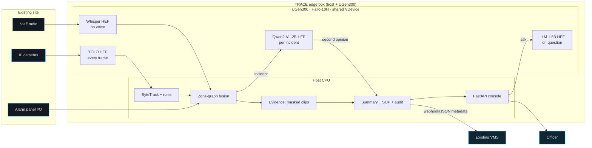

# TRACE — edge incident intelligence on a 2.5 W ASUS UGen300

**ASUS UGen AI League 2026 · Battlefield Lightning · Workplace AI**
Wei-Lun (Alen) Hsiao · B13902049 · National Taiwan University

TRACE is a copilot for the **station duty officer** who watches camera walls, an alarm panel and a
radio channel at the same time. It fuses cameras, alarm I/O and staff radio into **one
evidence-linked incident card per real-world event**, and wakes an on-device vision-language model
only when an incident needs a second opinion. The same pipeline screens road video for observable
risky motion (repeated lateral deviation, wrong-way travel) and never labels a rider.

Everything runs on the edge: raw video and audio never leave the box.

| | |
|---|---|
| Deck (Stage I) | `deck/b13902049_CN_league.pdf` |
| Demo video | see deck p.20 |
| Target hardware | ASUS UGen300 (Hailo-10H, 40 TOPS INT4, 8 GB, 2.5 W) |
| Prototype hardware | any laptop (tested: Apple M4 Pro, PyTorch MPS) |

## Why it matters

- In the Dec 19, 2025 Taipei Metro attack, **41 detector groups** fired across zones; operators had
  to reconstruct the event alarm by alarm.
- Taipei Metro is adding AI cameras: **280 → 2,901** (Phase I → II). More detectors mean more alerts.
- Operator attention drops after **~20 min** of monitoring; **94–98 %** of classic alarms are false.

Detection scales; attention doesn't. TRACE's unit of work is the *incident*, not the alert.

## How it works



1. **Sense** — YOLO + ByteTrack on every camera; per-camera rules emit signals
   (`crowd_surge`, `sudden_dispersal`, `person_down`, `lateral_weaving`, `wrong_way`,
   `speed_outlier`). Distances are normalised by body height / vehicle width, so rules work across
   camera heights without calibration. Whisper transcribes radio calls; the zone is the *last place
   mentioned* ("this is platform 2 … running toward exit C" → exit C).
2. **Relate** — `traceai/fusion.py`: a signal joins an open incident if it is within `window_s`
   of its last signal and within `max_hops` of the zone where the incident started (anchoring +
   a duration cap stop noise from chaining). Non-visual alarms pull **camera snapshots on demand**
   from the same and adjacent zones.
3. **Score** — noisy-OR with one vote per sensor, a confidence floor, and a corroboration factor
   rewarding independent source types; camera-only evidence is capped at *medium*; a confident human
   radio report plus any machine sensor is always *high*.
4. **Verify** — `traceai/verify.py`: only for fused incidents, Qwen2-VL-2B answers one targeted
   yes/no question on the keyframe (e.g. *is a train at the platform with passengers boarding?*).
   It may only **downgrade camera-only** incidents; it can never override an alarm or a human report.
5. **Explain** — masked 6-s clip + keyframe, timeline, summary where every clause cites a signal ID,
   a site-editable checklist (`configs/sop.yaml`), and an audit log of every machine and human action.
6. **Review & ask** — the console (`web/`) offers one-key confirm / escalate / dismiss and
   *Ask the station*: an on-device LLM answers questions from the event log only, with citations.

## Results (prototype)

**Alert storm (synthetic, 20 seeds, `scripts/simulate_alert_storm.py`)** — 16-zone station,
32 cameras, 16 detectors, 4 radios, one hour of nuisance alarms + 6 injected multi-zone incidents:

| per hour | cards | incident recall |
|---|---:|---:|
| every alarm is a card | 409 | 100 % |
| per-sensor de-dup (VMS-style) | 373 | 100 % |
| **TRACE high priority (30 s window)** | **9.4** | **99 %** |

False high-priority cards: 3.1/h at 30 s, 0.95/h at 20 s (97 % recall). See `results/`.

**Real footage** — metro run: 4 cameras + scripted intercom alarm + synthesised radio call → one
*high* incident ("Alarm corroborated by staff report", 5 signals) and one *low* crowd surge that the
VLM explains as a routine train arrival. Road run: 55 real scooter tracks on the Taipei Bridge
footage → 1 flagged for review.

**Measured stage latency** (Apple M4 Pro, PyTorch MPS, unoptimised): YOLO11n @960 px ≈ 47 ms/frame,
ByteTrack + rules < 1 ms, fusion < 1 ms, Whisper tiny.en ≈ 1.5 s for an 8.7 s call. Planning figures
for the Hailo-10H (Model Zoo, PCIe): YOLOv11n 302 FPS, Whisper-Base 25 tok/s, Qwen2-VL-2B 7 tok/s
(TTFT 1.0 s). USB throughput is the first Stage II measurement.

## Quick start

```bash
pip install -r requirements.txt
scripts/download_media.sh                      # openly licensed demo footage
python scripts/run_pipeline.py configs/metro_demo.yaml --vlm
python scripts/run_pipeline.py configs/road_demo.yaml --vlm
python -m traceai.server --replay              # http://127.0.0.1:8000
python -m pytest -q tests
python scripts/simulate_alert_storm.py --seeds 20 --window 30
```

The console also runs without a backend: `python -m http.server -d web 8765` → `/?mock=1`.

## Running on the UGen300

All accelerator code goes through `traceai/hailo.py`, written against HailoRT 5 and the official
`hailo-apps` examples (`create_infer_model`, `hailo_platform.genai.VLM`, `Speech2Text`). Every model
shares one `VDevice(group_id="TRACE")` so the HailoRT scheduler time-slices detection, speech and
the VLM on one chip.

```yaml
# configs/metro_demo.yaml
detector: {backend: hailo, hef: models/yolov8s_h10.hef}
asr: {backend: hailo, hef: models/Whisper-Base.hef}
```
```bash
python scripts/run_pipeline.py configs/metro_demo.yaml --vlm-hef models/Qwen2-VL-2B-Instruct.hef
```

Host code (tracking, rules, fusion, evidence, console) is identical on the laptop and the UGen300.

## Repository layout

```
traceai/      schema, perception (Ultralytics / Hailo), rules, fusion, verify (VLM), speech,
              summarize, evidence, ask, hailo, server
scripts/      run_pipeline, simulate_alert_storm, make_charts, build_deck, download_media
configs/      metro_demo.yaml, road_demo.yaml, sop.yaml
web/          operator console (vanilla JS, no build step; ?mock=1 for fixtures)
data/         pipeline outputs (run_*.json), synthesised radio audio
media/        privacy-masked evidence clips and keyframes
results/      benchmark outputs
deck/         Stage I proposal (HTML → PDF)
tests/        unit tests (fusion, VLM verifier, trajectories)
```

## Trust & privacy

No face recognition and no cross-camera re-identification. Head regions are blurred in every stored
frame. Video and radio audio are processed in memory; only short masked clips attached to incidents
are kept (24 h default) and only metadata goes upstream. Prompts forbid guessing identity, emotion,
intent or intoxication. A road flag describes motion only and always goes to a human.

## Honesty notes

- The metro "station" is stitched from stock clips of different real stations; the detector alarm
  and radio call are scripted inputs. Everything after the inputs is real pipeline output.
- The alert-storm benchmark uses synthetic alarms; triage-time figures in the deck are stated
  assumptions to be measured with operators in Stage II.
- Hailo-10H figures are from Hailo's published Model Zoo; they have not yet been measured on a UGen300.

Development was assisted by AI coding tools (Claude Code, OpenAI Codex). Media credits: `ATTRIBUTION.md`.
License: MIT.
