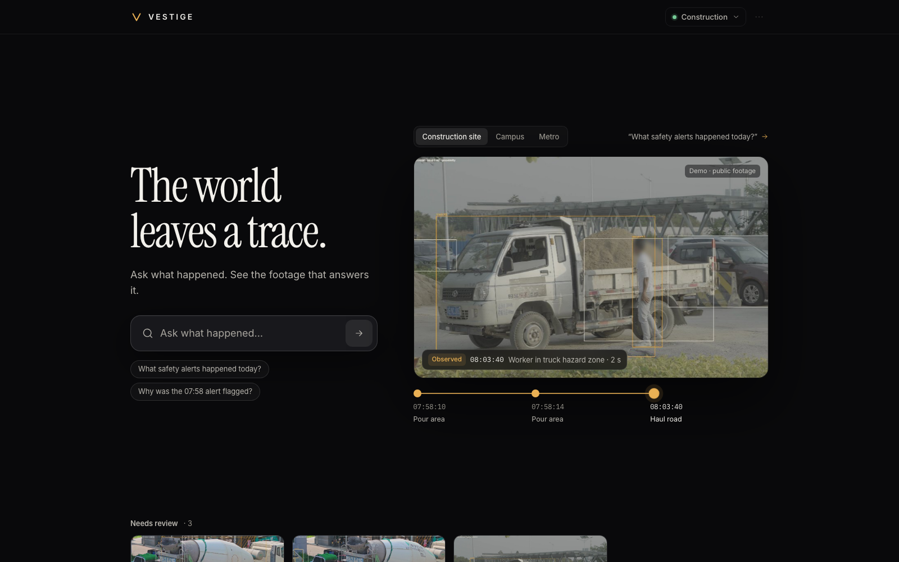
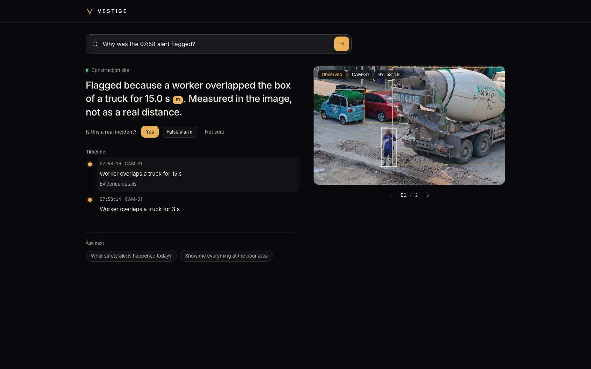
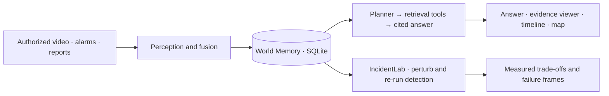

# VESTIGE

### The world leaves a trace.

**Ask what happened. Follow the evidence.**

VESTIGE turns authorized video, alarms and staff reports into a searchable memory of the physical world.
Ask “What happened to my bicycle?” and get a direct answer, a timeline and the footage behind each sighting.
One search box routes questions to the relevant authorized site. It distinguishes what a camera observed,
what the system inferred and where coverage ends.

**ASUS UGen AI League 2026 · Workplace AI · Battlefield Lightning · ASUS UGen300 target**

[Run locally](#quickstart) · [Try the demo](#a-three-minute-walkthrough) · [Measured results](#what-we-measured) · [Architecture](#how-it-works) · [Repository structure](#repository-structure) · [Submission checklist](docs/STAGE_I.md)



## Why VESTIGE

An operator reviewing an incident often has to search separate camera recordings, reconcile alarms and
remember what each source showed. VESTIGE puts that work into one flow: **remember → investigate → verify**.
VESTIGE stores observations with their source and evidence, retrieves them to answer questions,
and tests how perception holds up when footage gets darker, blurred or partially occluded.

The first intended market is construction-site operations; the demo also explores campus and metro use.
The three workspaces below are reproducible
**demonstrations using public footage and staged inputs**, not live customer deployments.

## A three-minute walkthrough

| Workspace | Try this | What to inspect |
|---|---|---|
| **Construction** | “What safety alerts happened today?” → **Why was it flagged?** | See the conclusion, frame and image-space rule behind a worker–vehicle alert. Record a human decision beside the answer. |
| **Campus** | “What happened to my bicycle?” | A recorded check-in, two direct sightings, candidate links across cameras, a map and an explicit end to coverage. Click a citation or timeline row to open its evidence. |
| **Metro** | “What happened before the emergency alert?” or select an alert under **Needs review** | Review the camera, scripted alarm and radio signals behind a fused incident. A staged recording outage remains a gap. |
| **More → Detection lab** | **New test** → **Benchmark** → Taipei Bridge scooters | Compare clean-frame detection retention under blur, low light, noise or occlusion. Run a test, inspect the frame comparison and download its report. |



<details>
<summary>More product views and sample outputs</summary>


[Sample cited answers and lab output](examples/) · [Mobile home](docs/screenshots/08a_mobile_home.png) ·
[Mobile answer](docs/screenshots/08_mobile_answer.png)

</details>

## Quickstart

Requires **Python 3.11+**, **FFmpeg** on `PATH`, and internet access for dependency, footage and first-use model downloads.
The current prototype uses a laptop CPU/GPU; an ASUS accelerator is **not required for Stage I**.
There is no frontend build step, API key or cloud account requirement for the default planner.

```bash
git clone https://github.com/AlenHsiaoWeiLun/trace-ugen.git
cd trace-ugen
python3 -m venv .venv
source .venv/bin/activate
python -m pip install -r requirements.txt

# Install FFmpeg first if needed: brew install ffmpeg (macOS)
# or sudo apt-get install ffmpeg (Debian/Ubuntu).
bash scripts/download_media.sh
python -m vestige
```

Open **[http://127.0.0.1:8100](http://127.0.0.1:8100)**. The first run builds `data/vestige.db` from video;
subsequent runs reuse it. Build time depends on the machine and first-use model downloads.

```bash
python -m vestige --port 8101      # use a different local port
python -m pytest -q tests         # include API, evidence and ingestion tests
python -m vestige --rebuild       # replace demo memory; removes local check-ins/reviews/experiments
```

**If setup fails:** the downloader preserves completed files so it can be rerun. If a media host rejects an
automated download, use its link in [ATTRIBUTION.md](ATTRIBUTION.md), save the video under the listed filename
in `data/videos/`, then rerun. Startup checks all scenario inputs and FFmpeg before resetting memory.
For offline operation, prepare footage and the YOLO weights under `models/` while online first.
See [reproduction and troubleshooting](docs/REPRODUCING.md) for exact scope and prerequisites.

## How it works



- **Perception:** YOLO11 + ByteTrack, short-gap tracklet stitching and track-level colour signatures.
- **Memory:** objects, tracks, observations, events, relations, evidence and coverage gaps persist in SQLite.
- **Investigation:** the default deterministic planner selects retrieval tools. Answer facts are composed from
  their results and cite stored evidence. Optional Qwen2-VL intent classification is separate and not needed
  to run the demo; this is not an unrestricted conversational agent.
- **Verification:** IncidentLab perturbs actual frames, reruns the detector and compares mitigations.

| Component | Running prototype | UGen300 plan for Stage II |
|---|---|---|
| Detection | Ultralytics YOLO11n/11s on laptop | Hailo-10H HEF through HailoRT; backend written, hardware validation pending |
| Tracking, association, memory, API and UI | Host CPU, SQLite, FastAPI, Preact | Remain on the host |
| Radio transcription / incident visual check | Existing TRACE replay; optional laptop Whisper / Qwen2-VL pipeline | Hailo Whisper / VLM backends written, hardware validation pending |
| Live cameras, access roles, automatic retention | Not implemented | Planned |

[Target deployment diagram](docs/architecture.png) (planned NPU placement, not measured hardware operation).
Model roles, configurations and the hardware measurement plan: [Hailo port](docs/hailo_port.md).
Feature-by-feature evidence: [implementation status](docs/STATUS.md). API: [reference](docs/vestige_api.md).

## Repository structure

Start with **`app/` for the current interface** and **`vestige/` for the application backend**.
`traceai/` provides shared perception/evidence code and the reproducible offline fusion pipeline.

```text
trace-ugen/
├── app/                     # Browser interface · Preact
│   ├── index.html
│   ├── app.js
│   ├── styles.css
│   ├── pages/
│   │   ├── ask.js
│   │   ├── lab.js
│   │   ├── sources.js
│   │   └── settings.js
│   ├── lib/
│   │   ├── api.js
│   │   ├── ui.js
│   │   └── site-map.js
│   └── vendor/
├── vestige/                 # Application backend · FastAPI, memory and investigation
│   ├── __main__.py
│   ├── api.py
│   ├── db.py
│   ├── scenarios.py
│   ├── ingest.py
│   ├── associate.py
│   ├── memory.py
│   ├── agent.py
│   └── incidentlab.py
├── traceai/                 # Shared perception, evidence and offline fusion modules
├── configs/                 # Replay pipeline configuration
├── scripts/                 # Downloads, experiments and presentation utilities
├── tests/                   # Automated checks
├── data/                    # Replay inputs and local database, videos and uploads
├── media/                   # Evidence frames, clips and lab comparisons
├── models/                  # Local model weights
├── results/                 # Saved experiment reports
├── examples/                # Sample API responses
├── docs/                    # Architecture, API, reproduction and submission guides
│   ├── ARCHITECTURE.md
│   ├── REPRODUCING.md
│   ├── STAGE_I.md
│   └── screenshots/
├── deck2/                   # VESTIGE slide sources and assets
├── requirements.txt
├── ATTRIBUTION.md
├── LICENSE
└── README.md
```

This overview expands the main application modules; supporting folders are grouped.
Downloaded weights, source videos, uploads, the local database and generated evidence are ignored by Git.
For module responsibilities and execution flows, see **[Software architecture](docs/ARCHITECTURE.md)**.

## What we measured

IncidentLab on **24 Taipei Bridge traffic frames**, level-2 perturbations, Apple M4 Pro development machine.
These are recorded laptop results, not fresh UGen300 measurements.

| Stress | Baseline retention | Best tested mitigation | Retention after mitigation |
|---|---:|---|---:|
| Partial occlusion | 33% | YOLO11s | **62%** |
| Motion blur | 56% | YOLO11s | **89%** |
| Sensor noise | 56% | Test-time augmentation | **92%** |

**Retention measures robustness, not ground-truth accuracy.** It is the share of the model's own clean-frame
boxes recovered after perturbation (same class, IoU ≥ 0.5). The run contains 98 reference detections;
occlusion is graded on the 58 hidden reference boxes. A larger model costs more latency: occlusion improved
by 29 percentage points at 75.4 vs 45.8 ms/frame. Enhancement can also hurt: low-light retention fell from
90% to 79% with the tested enhancement.

[Full road report](results/incidentlab_bench-road_X-dae2cec5.md) · [Station report](results/incidentlab_bench-station_X-31b01e45.md)

The older TRACE fusion experiment used **synthetic alarms**, not operational incident data. Its reports and
reproduction commands are listed in [REPRODUCING.md](docs/REPRODUCING.md); its recall should not be read as
real-world safety performance. No UGen300 throughput, power or live-site adoption result is claimed here.

## Evidence and limitations

- **Recorded / observed / inferred / unknown remain distinct.** Cross-camera links use topology, travel time
  and colour similarity; a similar bicycle is a candidate, not a confirmed identity.
- **Demonstration provenance is explicit.** Campus clips are retimed into a fictional site. The owner check-in,
  metro alarm/radio and recording outage are staged. Construction alerts measure bounding-box overlap in
  an uncalibrated image, not physical distance or intent.
- **Privacy masking is implemented.** Stored frames and processed video blur detected head regions; there is
  no face recognition. Masking depends on detection and is not a guarantee of complete anonymization.
- **Local processing is the default.** Media/model downloads require internet; the default investigation path
  does not send footage to a cloud service.
- **This is a local prototype.** The demo allow-list checks workspace scope but is not production authentication.
  Upload authorization is a user declaration, and automatic retention is not enforced yet.

## Stage I submission

[Current requirements and readiness checklist](docs/STAGE_I.md), checked against the organizer's published
rules on **11 October 2026**. Stage I permits laptop validation; Stage II requires the selected platform.

| Material | Repository status |
|---|---|
| Code, setup, architecture and measured results | Available here |
| English deck | [Existing TRACE draft: 20 main pages + 2 appendices](docs/trace-proposal-draft.pdf). It predates the VESTIGE product UI. Latest VESTIGE slide sources are in [deck2/](deck2/); a final matching PDF still needs to be exported and checked. |
| English demo video, YouTube unlisted | **Pending — no verified submission URL in this repository** |

The README and screenshots support review; they do not replace the required deck and video.

## Project and credits

Built by **Wei-Lun Hsiao · Computer Science, National Taiwan University**.

Development used Claude Code and OpenAI Codex. Public footage, hardware renders and generated deck imagery
have separate provenance: [media attribution](ATTRIBUTION.md). Project-authored code is provided under
[MIT](LICENSE); third-party code, model weights and media retain their own terms, including the
[Ultralytics license](https://github.com/ultralytics/ultralytics/blob/main/LICENSE).
