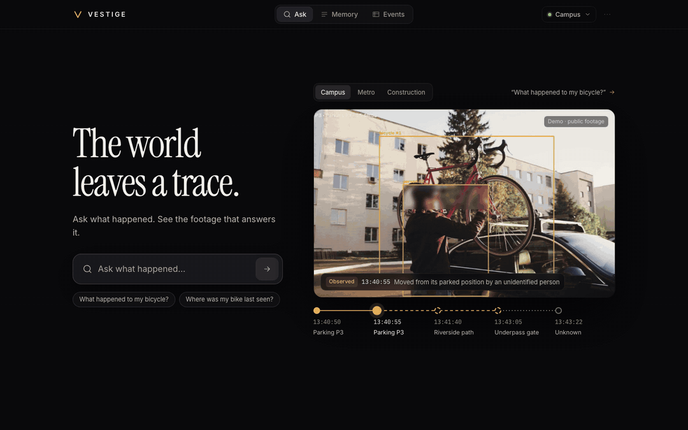
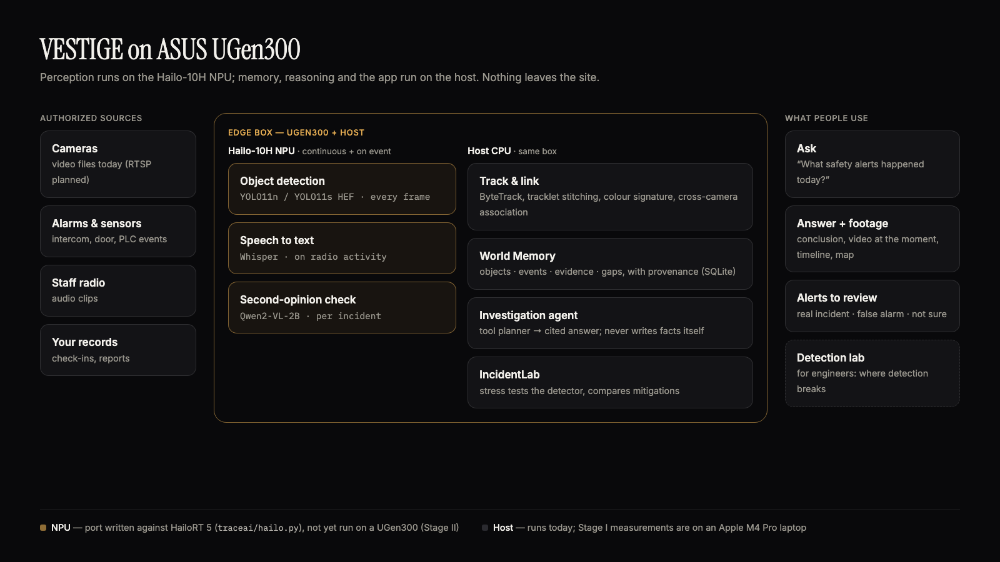

# VESTIGE — The world leaves a trace

**Ask what happened to an object, a place or an event — and get an answer backed by the footage.**
VESTIGE is an edge AI memory for the physical world: it turns authorized cameras, alarms and staff reports into a
searchable record of objects and events, answers questions with the evidence attached, and says plainly what is
observed, what is inferred and what is unknown.

ASUS UGen AI League 2026 · Battlefield Lightning (ASUS UGen300 · Hailo-10H) · Workplace AI
Wei-Lun Hsiao · B13902049 · National Taiwan University · *VESTIGE — an Archean project (provisional)*



## Status — what works today

| Part | Status | Notes |
|---|---|---|
| Detection + tracking on video (YOLO11 + ByteTrack + tracklet stitching) | ✅ Done, tested | runs on a laptop today |
| World Memory: objects, events, evidence, coverage gaps, provenance on every row | ✅ Done, tested | SQLite |
| Cross-camera links (camera adjacency + travel time + colour) | ✅ Done, tested | stored as *inferred*, never as identity |
| Ask: one search box for every site — it works out which site the question is about; conclusion, evidence video at the moment, timeline, map | ✅ Done, tested | deterministic tool planner + site routing; optional local LLM picks intent only |
| Alerts to review: lead-up, why it was flagged, real / false alarm / not sure + audit log | ✅ Done, tested | |
| IncidentLab: stress tests (low light, blur, noise, low-res, occlusion, scale) + mitigations | ✅ Done, measured | results below |
| Three demo workspaces: **construction safety (first market)**, campus bicycle, metro incident | ✅ Done | public footage + staged inputs, labelled; not a WanZe site |
| Upload authorized footage → background processing → ask | ✅ Done, tested | file sources |
| Running the models on the UGen300 (Hailo-10H) | ⏳ Stage II | HailoRT 5 port written (`traceai/hailo.py`), not yet run on hardware |
| Live RTSP cameras, multi-user roles, retention enforcement | ⏳ Stage II | |
| Construction-specific machinery model | ⏳ Stage II | needs site data from a pilot |

Every feature with its evidence: [`docs/STATUS.md`](docs/STATUS.md) · 33 automated tests (`python -m pytest -q tests`).

## Quickstart

```bash
pip install -r requirements.txt     # Python 3.11+, ffmpeg on PATH
scripts/download_media.sh           # openly licensed demo footage (not redistributed here)
python -m vestige                   # first run builds the memory (~2 min), then http://127.0.0.1:8100
```

No time to run it? [`examples/`](examples) has real outputs: cited answers for each scenario
(`answer_*.json`) and an IncidentLab summary. Screenshots: [`docs/screenshots/`](docs/screenshots).

## Does the technology actually help? (measured)

**IncidentLab on dense Taipei Bridge scooter traffic** — 24 frames, 98 reference detections, level-2 stress
([full report](results/incidentlab_bench-road_X-dae2cec5.md)):

| Stress | Baseline YOLO11n | Most improved in this test | Retention | Gain |
|---|---:|---|---:|---:|
| Partial occlusion | 33 % | Larger model (YOLO11s) | 62 % | **+29 pp** |
| Motion blur | 56 % | Larger model (YOLO11s) | 89 % | **+33 pp** |
| Sensor noise | 56 % | Test-time augmentation | 92 % | **+36 pp** |
| Low light | 90 % | Simple brightening (CLAHE) | 79 % | **−11 pp** — enhancement can hurt |

*Retention* = share of the model's own clean-frame detections it still finds (IoU ≥ 0.5). It measures robustness,
not accuracy against human labels. On the Hailo-10H the same trade-off is YOLOv11n 302 FPS vs YOLOv11s 142 FPS
(Hailo-published, PCIe) — both fit 8 cameras × 15 fps; *we have not measured a UGen300 yet.*

**Found by testing our own pipeline:** tracklet stitching (ByteTrack split the red bicycle into 4 tracks on one
camera; without stitching no cross-camera chain formed) · track-level colour signature (same bike 0.57–0.59,
a different bike 0.11–0.17) · the VLM check is correct only on clean, masked frames — drawn boxes broke it.
**TRACE fusion** (synthetic alert storm, 20 seeds): 409 alarms/h → 9.4 high-priority cards, 99 % incident recall.
**Latency:** investigation query 1.6–3 ms; YOLO11n ~47 ms/frame at 960 px (laptop GPU).

## Architecture



| Runs on | What |
|---|---|
| **Hailo-10H NPU** (UGen300) | object detection every frame (YOLO11 HEF) · speech-to-text on radio activity (Whisper) · second-opinion check per incident (Qwen2-VL-2B) |
| **Host CPU** (same box) | tracking + stitching, colour signature, cross-camera association, World Memory, investigation agent, IncidentLab, API + app |

Code: `vestige/` (memory, ingestion, association, agent, IncidentLab, API) · `app/` (web app, no build step) ·
`traceai/` (TRACE engine: perception, alarm/radio/camera fusion, Hailo backends) · `tests/` · `scripts/`.
Hailo details: [`docs/hailo_port.md`](docs/hailo_port.md) · API: [`docs/api.md`](docs/api.md).

## Privacy and trust

- **No face recognition.** People are anonymous tracks; heads are blurred in every stored frame and processed video.
- **Video stays on site.** Everything runs on the edge box; nothing is sent to a cloud service.
- **Authorized sources only** — uploads require an explicit authorization; workspaces are isolated (tested).
- **Gaps stay gaps.** Missing footage is shown as unknown, never filled in.
- **Movement is not theft, proximity is not intent, similar appearance is not identity** — the answers say so.
- Every question and review is written to an audit log.

## Stage II roadmap

1. **Port to the UGen300**: run the YOLO11 HEF, Whisper and Qwen2-VL on the Hailo-10H; measure FPS, latency and power
   on hardware and replace every published number with a measured one.
2. **Live cameras** (RTSP) and multi-camera time sync on the edge box.
3. **Construction pilot**: early collaboration talks with WanZe Construction (萬澤建設) — scope and terms not yet
   defined. Goal: machinery-aware proximity events and a site-specific IncidentLab benchmark.
4. First user study: time-to-answer with and without VESTIGE.

## Honesty notes

Footage is public stock video re-timed into demo sites; the bicycle owner's check-in, the metro alarm and radio call
and the CAM-05 outage are staged inputs, labelled at row level. These are reconstructions, not real incidents, and
we have no access to NTU, Taipei Metro or real CCTV. IncidentLab compares against the model's own clean-frame output,
not human labels. Hailo performance figures are Hailo's. Built with help from AI tools (Claude Code, OpenAI Codex).
Media credits: [`ATTRIBUTION.md`](ATTRIBUTION.md) · License: MIT.

## Links

- Stage I deck: `b13902049_CN_league.pdf` (submitted with the entry)
- Demo video (YouTube, unlisted): *added at submission*
- Contact: Wei-Lun Hsiao · B13902049 · CSIE, National Taiwan University
