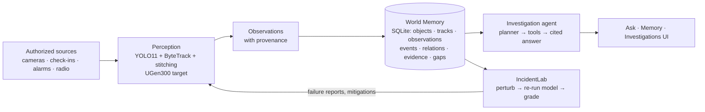

# VESTIGE — The World Leaves a Trace

**An AI memory and investigation platform for the physical world.**
ASUS UGen AI League 2026 · Battlefield Lightning (ASUS UGen300 · Hailo-10H) · Workplace AI
Wei-Lun (Alen) Hsiao · B13902049 · National Taiwan University · *VESTIGE — an Archean project (provisional)*

VESTIGE turns authorized camera footage, alarms and staff reports into a **persistent memory of objects
and events**, answers questions such as *"What happened to my bicycle?"* with a timeline in which **every
camera sighting cites a stored frame** (user records and coverage gaps are labelled as such, never dressed up
as sightings), and **stress-tests its own perception** in IncidentLab. The underlying
engine is **TRACE** (perception, fusion, evidence).

| | |
|---|---|
| Run it | `python -m vestige.api` → http://127.0.0.1:8100 |
| Status of every feature | [`docs/STATUS.md`](docs/STATUS.md) |
| Screenshots | [`docs/screenshots/`](docs/screenshots) |
| Hailo port | [`docs/hailo_port.md`](docs/hailo_port.md) |
| Stage I deck sources | `deck2/` |

## Three capabilities, one engine



- **REMEMBER** — detections become stored observations with an explicit evidence state:
  `RECORDED` (a user or system record), `OBSERVED` / `LAST_SEEN` (camera evidence), `INFERRED`
  (cross-camera link), `UNKNOWN` (explicit gap). States are never merged.
- **INVESTIGATE** — a deterministic tool planner calls `search_objects`, `get_object_history`,
  `search_events`, `get_event_timeline`, `get_evidence`, `get_source_coverage`; the answer is composed only
  from their results and cites `[E#]` evidence that opens the stored frame / processed video at that moment.
  Optional local LLM (`VESTIGE_LLM=qwen`) may only choose an intent label; it never writes facts.
- **VERIFY (IncidentLab)** — pick an event, a benchmark set or a camera; apply low light, blur, noise,
  low resolution, partial occlusion or scale; re-run the real detector; report **Detection Retention Rate**
  (share of the model's clean-frame detections it still finds — *not* ground-truth recall) and compare
  test-time **mitigations**: corruption-aware enhancement, higher resolution, test-time augmentation,
  a larger model.

## Results (measured on this repository, Apple M4 Pro laptop)

**IncidentLab on dense Taipei Bridge scooter traffic** (`bench-road`, 24 frames, 98 reference detections,
level-2 perturbations; [`results/incidentlab_bench-road_X-dae2cec5.md`](results)):

| Perturbation | Baseline YOLO11n | Best mitigation | Retention | Gain | Cost |
|---|---:|---|---:|---:|---|
| Partial occlusion | 33 % | Larger model (YOLO11s) | 62 % | **+29 pp** | 75 vs 46 ms/frame; more new detections |
| Motion blur | 56 % | Larger model (YOLO11s) | 89 % | **+33 pp** | 75 vs 50 ms/frame |
| Sensor noise | 56 % | Test-time augmentation | 92 % | **+36 pp** | 111 vs 47 ms/frame |
| Low light | 90 % | Larger model | 98 % | +8 pp | — |
| Low light | 90 % | Naive enhancement (CLAHE) | 79 % | **−11 pp** | enhancement can hurt |

Station crowds (`bench-station`) are already robust (91–96 % baseline); mitigations add 1–4 pp.
On the Hailo-10H the same trade-off is YOLOv11n 302 FPS vs YOLOv11s 142 FPS (published, PCIe) — both fit
8 cameras × 15 fps. *Hardware numbers are Hailo's; we have not measured a UGen300 yet.*

**Engineering improvements found by testing our own pipeline**
- *Tracklet stitching* (`vestige/ingest.py::stitch`) — ByteTrack split the red bicycle into 4 tracklets on
  CAM-G2; stitching merges same-class tracklets across short gaps (2 tracks after). Without it no
  cross-camera chain formed.
- *Track-level colour signature* — averaging hue histograms over the whole track instead of one frame made
  the same bicycle's similarity stable (0.57–0.59) and kept a different (silver) bicycle at 0.11–0.17.
- *Overlay-free VLM input* — Qwen2-VL answered the "train at platform?" check correctly only on the clean,
  privacy-masked frame; drawn boxes broke it.

**TRACE fusion (synthetic alert storm, 20 seeds)** — 409 alarms/h → 9.4 high-priority cards, 99 % incident
recall, 3.1 false high cards/h; per-sensor de-duplication alone removes 9 %. `scripts/simulate_alert_storm.py`

**Latency** — World Memory investigation query: 1.6–3 ms; YOLO11n @ 960 px: ~47 ms/frame (MPS);
ingestion of a 12 s 1080p clip incl. masked proxy video: ~9 s.

## Demo scenarios (`python -m vestige.scenarios` rebuilds everything from footage)

| Workspace | Footage | What VESTIGE does |
|---|---|---|
| **Campus** | 4 Pexels clips stitched into a site with topology P3/P5 → W1 → G2 | B-17 check-in (RECORDED, staged) → seen at P3 → *left its parked position, handled by person #2* (OBSERVED) → similar red bicycle on W1 and G2 (INFERRED: adjacency + 39 s / 81 s travel + colour 0.59) → *no camera beyond G2* (UNKNOWN). A silver bicycle leaving P5 is checked and **not linked**. |
| **Metro demo** | TRACE replay (stock clips + scripted intercom alarm + Whisper-transcribed radio) | Fused incident; timeline of the 60 s before the alarm; CAM-05 "live only, no replay" window shown as an evidence gap (staged). |
| **Construction** | 2 Pexels site clips | Worker–truck image-space proximity events (operators inside cabs excluded), "why was this flagged" with the exact rule, IncidentLab stress test of the event. Not a WanZe site. |

Example questions: *What happened to my bicycle?* · *Where was my bike last seen?* · *Show me everything near
the underpass gate* · *What happened before the emergency alert?* · *Why was this construction safety event flagged?*

## Install & run

```bash
pip install -r requirements.txt            # Python 3.11+, ffmpeg on PATH
scripts/download_media.sh                  # openly licensed footage (not redistributed)
python -m vestige.scenarios                # builds data/vestige.db with real perception (~2 min)
python -m vestige.api --port 8100          # app + API
python -m pytest -q tests                  # 30 tests (tests run on a copy of the database)
python scripts/screenshots.py docs/screenshots
```

Configuration: `VESTIGE_LLM=qwen` enables the optional local intent classifier (needs `models/qwen2-vl-2b`).
Detector backend: `detector_cfg={"backend": "hailo", "hef": ".../yolov8s.hef"}` in `vestige/ingest.py`
uses `traceai/hailo.py` (HailoRT 5, shared VDevice) — written against Hailo's official examples; **not yet
validated on hardware**.

## Data model

`workspaces · zones · sources (provenance, license, recording_available) · topology (travel windows) ·
objects · tracks (path, colour signature) · observations (status, provenance, evidence) · events ·
event_links · relations (moved_by / same_object_candidate with basis, INFERRED or REJECTED) · evidence
(sha256, frame, offset) · gaps · experiments · experiment_results · jobs · audit` — see `vestige/db.py`.

## Trust & privacy

Authorized sources only (upload requires an explicit authorization flag) · workspace isolation (403 across
workspaces) · no face recognition; people are pseudonymous tracks and heads are blurred in every stored
frame and in the processed proxy video · staged and synthetic data are labelled at row level · missing
footage is shown as a gap, never filled · movement ≠ theft, proximity ≠ intent, similar appearance ≠
identity · every review and question is written to the audit log.

## Honesty notes

Footage is public stock video re-timed into demo sites; the owner check-in, the metro alarm and radio
call and the CAM-05 outage are staged inputs. IncidentLab reports robustness against the model's own
clean-frame output, not human labels. Hailo performance figures are published by Hailo. Development was
assisted by AI tools (Claude Code, OpenAI Codex); images in the deck marked as AI-generated were made with
an OpenAI image model. Media credits: `ATTRIBUTION.md`. License: MIT.
