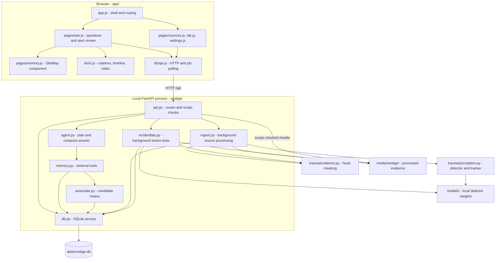
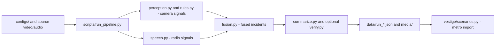

# VESTIGE software architecture

This describes the implemented application in this repository. The [hardware deployment diagram](architecture.png)
shows the UGen300 target; Hailo hardware execution remains unvalidated. The annotated directory tree is in
[the README](../README.md#repository-structure).

## Current runtime

VESTIGE is a local application: one FastAPI process serves both the browser modules and HTTP API,
uses a local SQLite database, and starts ingestion/lab jobs in background threads. There is no separate
frontend build, hosted database, message broker or cloud inference service in the default path.

`memory.js` still includes an older standalone page, but `ask.js` now imports its `SiteMap` directly.
The retained `investigate.js` page is not registered by the current `app.js` router; event investigation
and review now happen in `ask.js`. Their APIs remain available.

## Execution flows

### Startup and demo build

1. `python -m vestige` enters [vestige/__main__.py](../vestige/__main__.py).
2. If `data/vestige.db` is missing, or `--rebuild` was requested,
   [scenarios.py](../vestige/scenarios.py) checks all required scenario files and FFmpeg before resetting memory.
3. Campus and construction videos pass through `ingest.process_source()`: detection and tracking,
   tracklet stitching, appearance extraction, event rules and masked evidence generation.
   Campus candidate links are then built by `associate_workspace()`.
4. Metro imports the committed `data/run_metro.json` and its evidence; startup does **not** rerun metro
   speech recognition, fusion or a VLM. Benchmark sources are also registered.
5. Uvicorn serves [api.py](../vestige/api.py), which serves `app/` at `/`.
   Normal restarts reuse the database; `--rebuild` replaces local reviews, check-ins and experiments.

### A question and its evidence

1. `app/pages/ask.js` calls `app/lib/api.js` with a question and workspace, optionally an event ID.
2. `POST /api/workspaces/{ws}/ask` checks access and passes the request to `agent.ask()`.
3. `agent.py` chooses an intent and calls the deterministic retrieval functions in `memory.py`.
   Object histories include candidate chains from `associate.py` and explicit coverage gaps.
4. The response includes a conclusion, steps, citations and retrieval metadata, composed from returned records.
   The optional local Qwen path only classifies an unresolved intent; it does not author answer facts.
5. `ui.js` renders the timeline and evidence viewer. Citation URLs resolve to stored images or processed video
   served through the API's workspace-scoped `/media/` handler.
6. For an event, a human decision is posted to `/api/events/{eid}/review` and persisted with an audit entry.

### Upload and ingestion

1. `sources.js` submits a multipart video upload to `/api/workspaces/{ws}/sources`.
2. `api.py` records source metadata, stores the file under `data/uploads/` and starts a processing job.
3. `ingest.py` uses the shared detector/tracker and masking primitives to write tracks, observations,
   evidence and events into SQLite, with processed media under `media/vestige/{workspace}/`.
4. The browser polls `/api/jobs/{id}` until completion or a surfaced failure; questions subsequently retrieve
   the new stored records. Upload processing does not automatically create camera topology or rerun
   cross-camera association; that association is explicitly called during the campus scenario build.

### Detection stress test

1. `lab.js` sends the workspace, frame scope, perturbations and mitigations to `/api/lab/experiments`.
2. `api.py` validates the scope/configuration and starts `incidentlab.run()` as a background job.
3. `incidentlab.py` samples source frames, obtains clean reference detections, perturbs the frames and reruns
   the detector for each mitigation. This uses local Ultralytics models, not a verified Hailo execution path.
4. Counts, retention, latency and configuration persist in `experiments` and `experiment_results`;
   comparison images go under `media/vestige/lab/{experiment}/`.
5. `lab.js` polls the job and retrieves results. The Markdown download is composed from database rows by
   `report_markdown()`; reports saved in `results/` are exported snapshots, not the live database.

## Storage and ownership

| Location | Contents and producer | Git status |
|---|---|---|
| `data/vestige.db` | `db.py`: workspaces, zones, sources, topology, objects, tracks, observations, evidence, events/links, relations, gaps, experiments/results, jobs and audit | Generated, ignored |
| `data/videos/` | Source footage downloaded by `scripts/download_media.sh` | Downloaded, ignored |
| `data/uploads/` | Authorized uploads saved by `api.py` | Generated, ignored |
| `media/vestige/` | Masked evidence and lab comparisons from ingestion/lab; metro copies from committed replay | Generated, ignored |
| `models/` | Downloaded YOLO weights and optional local model files | Downloaded, ignored |
| `data/run_*.json`, `data/tracks_road.json`, `data/audio/` | Earlier replay outputs and scripted radio input | Committed |
| `media/metro/` | Earlier metro replay evidence needed by the demo import | Committed |
| `results/`, `examples/` | Saved experiment reports and sample API outputs | Committed snapshots |

Rows use `workspace_id` and provenance/status fields to distinguish sources and evidence types. Inferred
cross-camera matches are candidate relations, not proof of identity. The current access check is a demo
allow-list, not multi-user authentication; stored retention settings do not implement automatic deletion.

## Shared code and the earlier replay pipeline

The current ingestion path imports detection/tracking from `traceai/perception.py` and masking from
`traceai/evidence.py`. IncidentLab also uses the masking helper. The optional intent classifier reuses the
local model wrapper in `traceai/summarize.py`.

The earlier offline flow remains reproducible through `scripts/run_pipeline.py`:

`traceai/schema.py` defines that pipeline's signal/incident types. `traceai/perception.py` includes a planned
Hailo detector backend; `traceai/hailo.py` contains speech/VLM adapters. Their presence does not mean the
default VESTIGE demo runs on UGen300. See [the hardware plan](hailo_port.md) for that boundary.

## Where to make a change

| Change | Start here |
|---|---|
| Main user flow, alert inbox or review controls | `app/pages/ask.js` |
| Object map | `app/pages/memory.js` → `SiteMap` |
| Timeline/citations/video interaction | `app/lib/ui.js` |
| Routes, upload validation or background jobs | `vestige/api.py` |
| Question intent or answer composition | `vestige/agent.py` |
| Retrieved facts and object/event histories | `vestige/memory.py` |
| Source processing or campus/construction event rules | `vestige/ingest.py` |
| Cross-camera candidate matching | `vestige/associate.py` |
| Database schema or audit writes | `vestige/db.py` |
| Demo inputs, topology or staged records | `vestige/scenarios.py` |
| Detector stress tests or report metrics | `vestige/incidentlab.py`, `app/pages/lab.js` |
| Shared detector/tracker or privacy masking | `traceai/perception.py`, `traceai/evidence.py` |

API contracts: [vestige_api.md](vestige_api.md). Setup and verification: [REPRODUCING.md](REPRODUCING.md).
These descriptions are based on the current imports, routes and storage paths; they do not claim
that live RTSP ingestion, production authentication or hardware deployment is implemented.
